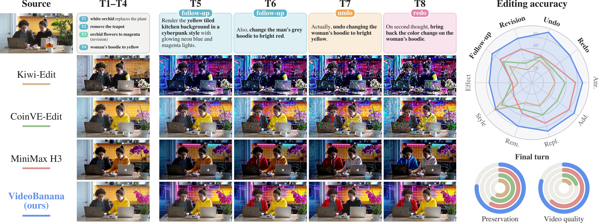
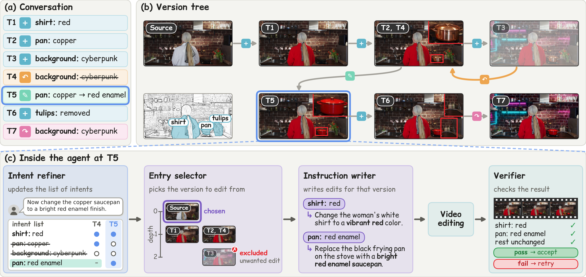
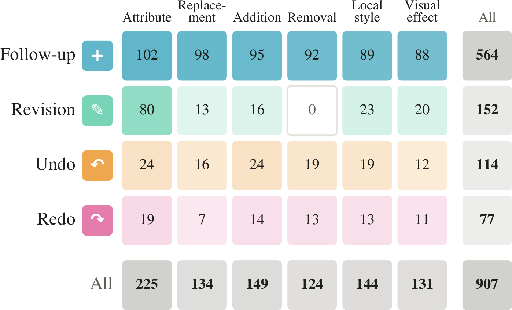
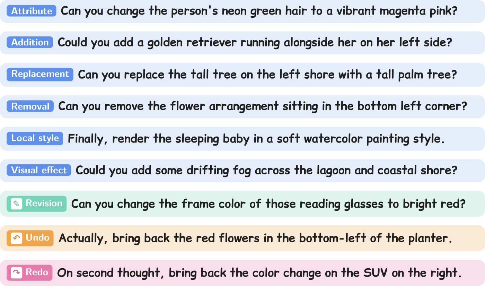
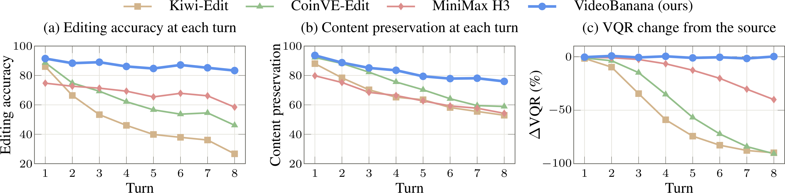

<div align="center">

# VideoBanana: Agentic Multi-Turn Conversational Video Editing

Jiayi Zhang<sup>1</sup>, Xiangbo Gao<sup>2</sup>, Vardhan Dongre<sup>3</sup>, Franck Dernoncourt<sup>4</sup>, Ryan A. Rossi<sup>5</sup>, Zhengzhong Tu<sup>2</sup>

<sup>1</sup>University of Wisconsin–Madison &nbsp; <sup>2</sup>Texas A&M University &nbsp; <sup>3</sup>University of Illinois Urbana-Champaign<br><sup>4</sup>Adobe Research &nbsp; <sup>5</sup>Zillow

[]()
[](https://jiayizhanga.github.io/VideoBanana/)
[](https://huggingface.co/datasets/JiayiZhang14/ChatVE-Bench)

</div>

## 🔥 News

- **[2026-11]** ChatVE-Bench is released on [Hugging Face](https://huggingface.co/datasets/JiayiZhang14/ChatVE-Bench).

## ✅ Release Plan

- [x] ChatVE-Bench data
- [ ] ChatVE-Bench evaluation code
- [ ] VideoBanana code

## 📖 Introduction

<p align="center">
  
</p>

**ChatVE-Bench** is a benchmark of multi-turn, conversational video editing. Its 144 sessions of 5 to 8
turns add follow-up edits, revise earlier edits, undo any earlier step, and redo undone edits. Every turn
is scored with a checklist built from the expected state of the session.

**VideoBanana** is an agent that treats such editing as tracking the goal of the conversation over a tree
of verifier-scored checkpoints.

## 🛠️ Method

<p align="center">
  
</p>

VideoBanana has three parts around an unchanged editor: goal tracking restates what the user wants after
every turn, a verifier-scored checkpoint tree chooses the video to edit from, and a verifier checks each
output against the whole goal before it is committed and records what it shows.

## 📊 ChatVE-Bench

<p align="center">
  
</p>

<p align="center">
  
  
</p>

```bash
hf download JiayiZhang14/ChatVE-Bench --repo-type dataset --local-dir ChatVE-Bench
```

## 📈 Results

<p align="center">
  
</p>

Editing accuracy, content preservation, and video quality across the turns of a session. The baselines
decline on all three as their outputs undergo successive generations. VideoBanana keeps its outputs within
a few generations of the source and declines far less.

## 📝 Citation

```bibtex
@article{zhang2026videobanana,
  title   = {VideoBanana: Agentic Multi-Turn Conversational Video Editing},
  author  = {Zhang, Jiayi and Gao, Xiangbo and Dongre, Vardhan and
             Dernoncourt, Franck and Rossi, Ryan A. and Tu, Zhengzhong},
  journal = {arXiv preprint},
  year    = {2026}
}
```

## 📄 License

ChatVE-Bench is released under the Apache License 2.0. Its source clips are cut from
[VEFX-Bench v1.0](https://huggingface.co/datasets/xiangbog/VEFX-Bench) (Apache License 2.0).
